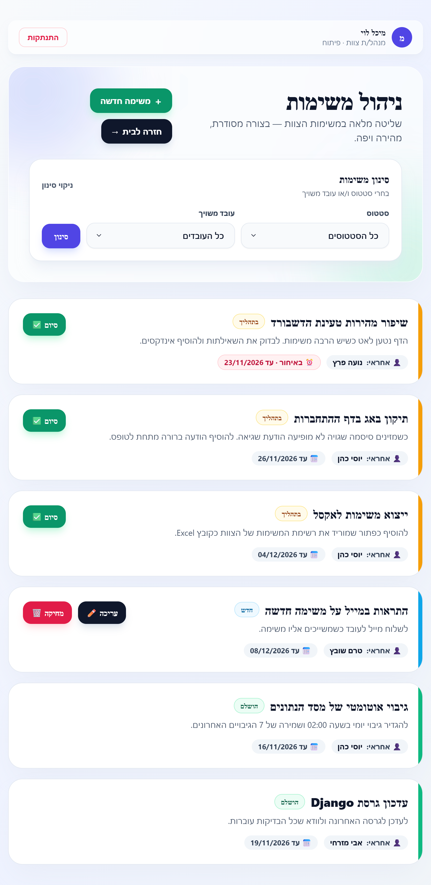
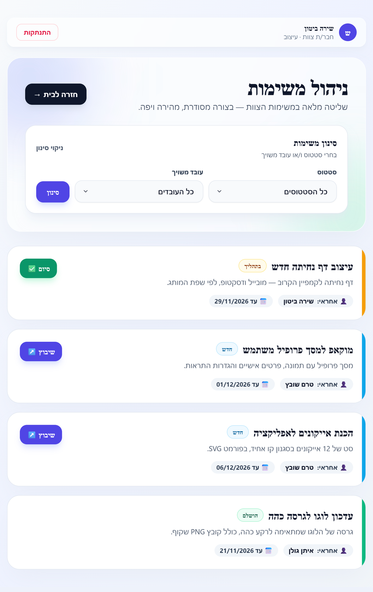
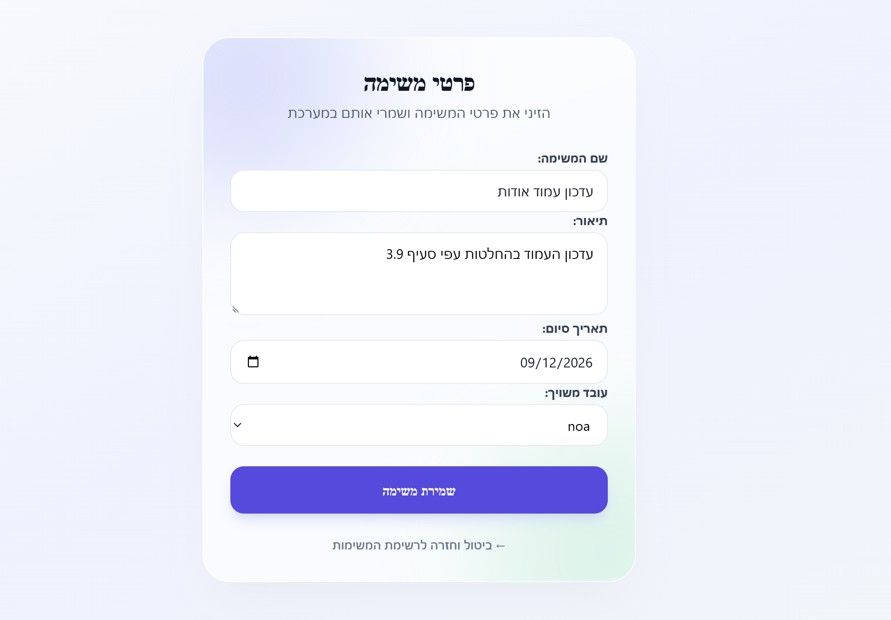
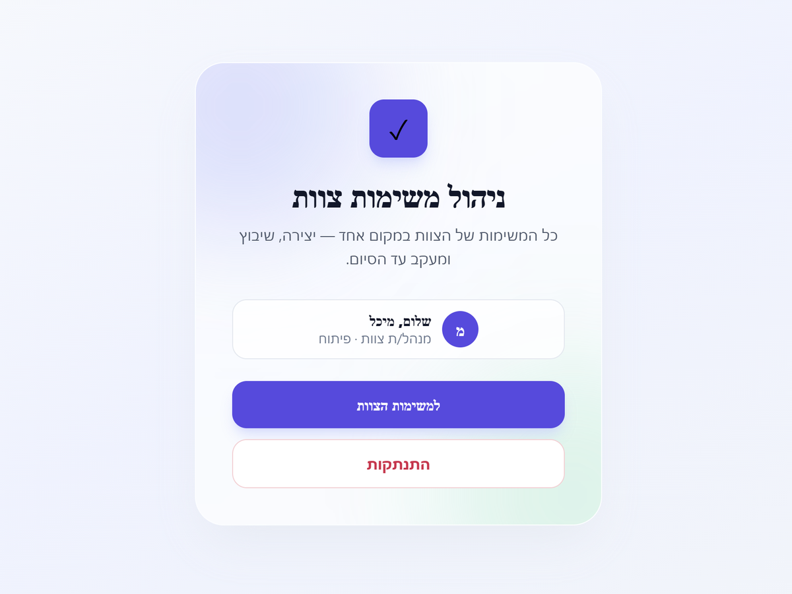
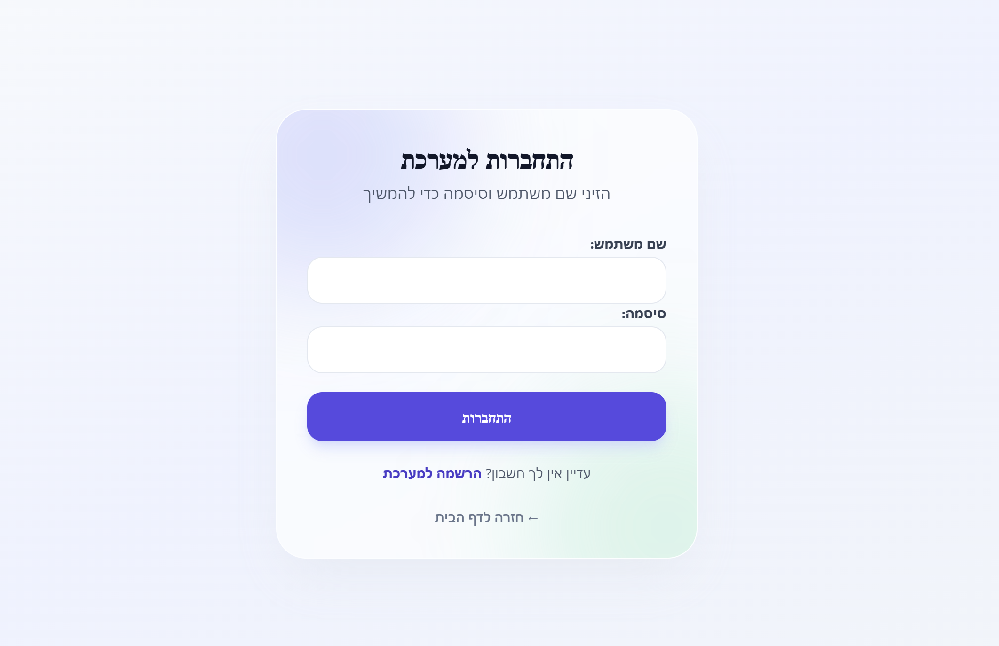
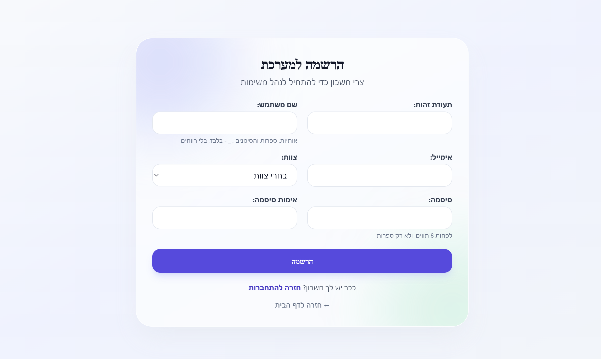
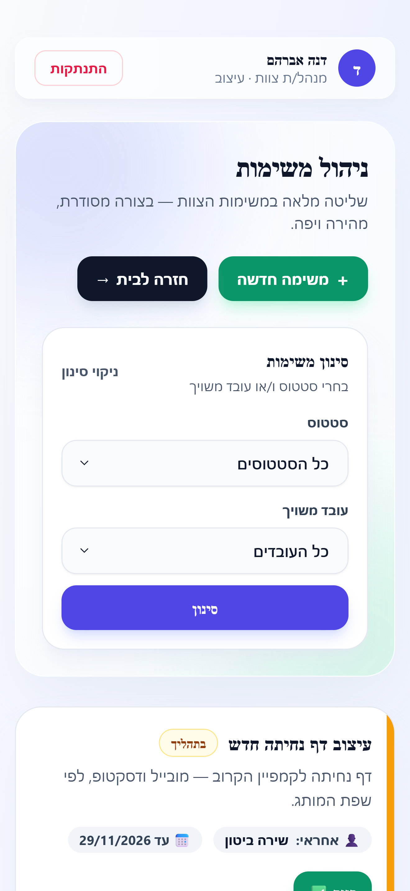
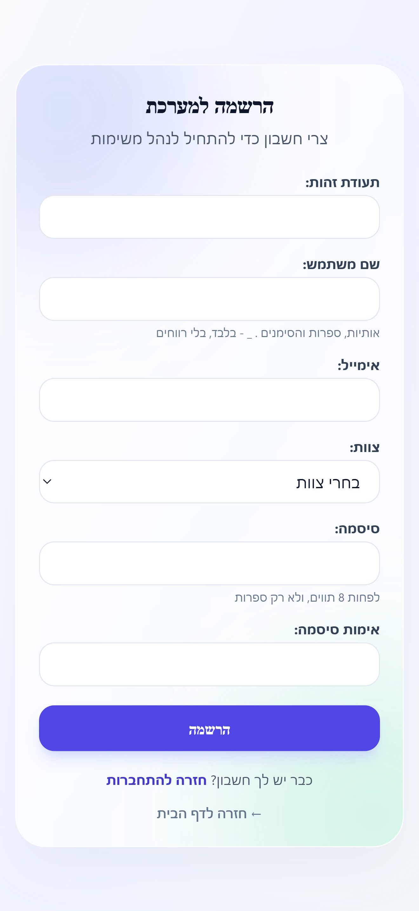

# מערכת לניהול משימות צוות

אפליקציית ווב ב-**Django** לניהול משימות של צוותי עבודה. כל משתמש שייך לצוות, מנהלי הצוות יוצרים משימות, והעובדים משבצים את עצמם למשימות ומסמנים אותן כהושלמו.
הממשק בעברית (RTL) ומעוצב עם Tailwind CSS.

## מה המערכת יודעת לעשות

| פעולה | מי יכול |
|---|---|
| הרשמה (עם בחירת צוות) והתחברות / התנתקות | כולם |
| צפייה במשימות של הצוות שלי | כל משתמש מחובר |
| צפייה בתאריך הסיום של כל משימה, וסימון אדום למשימות באיחור | כל משתמש מחובר |
| סינון משימות לפי סטטוס (חדש / בתהליך / הושלם) ולפי שיבוץ (לא משויך / המשימות שלי) | כל משתמש מחובר |
| יצירת משימה חדשה | מנהל (`role = admin`) |
| עריכה ומחיקה של משימה שעוד לא שובצה | מנהל |
| שיבוץ עצמי למשימה פנויה (הסטטוס עובר ל"בתהליך") | עובד (לא מנהל) |
| סימון משימה כ"הושלם" | מנהל, או העובד שמשובץ למשימה |
| ניהול צוותים, משתמשים ומשימות, וקביעת מי מנהל | ממשק הניהול של Django (`/admin/`) |

## צילומי מסך

<p align="center">
  
  <br>
  <sub><b>רשימת המשימות — תצוגת מנהלת:</b> משימות בשלושה סטטוסים, תאריכי סיום וסימון משימות באיחור</sub>
</p>

<table>
  <tr>
    <td align="center" width="50%">
      <br>
      <sub><b>תצוגת עובד</b> — שיבוץ עצמי וסימון משימה כהושלמה</sub>
    </td>
    <td align="center" width="50%">
      <br>
      <sub><b>משימה חדשה</b> — המנהלת יוצרת ומשייכת משימות</sub>
    </td>
  </tr>
</table>

<table>
  <tr>
    <td align="center" width="33%">
      <br>
      <sub><b>דף הבית</b></sub>
    </td>
    <td align="center" width="33%">
      <br>
      <sub><b>התחברות</b></sub>
    </td>
    <td align="center" width="33%">
      <br>
      <sub><b>הרשמה</b></sub>
    </td>
  </tr>
</table>

### 📱 מותאם למובייל

<p align="center">
  
  &nbsp;&nbsp;&nbsp;&nbsp;
  
</p>

## מבנה הפרויקט

```
python/
├── manage.py              # כלי ההפעלה של Django (הרצת שרת, מיגרציות וכו')
├── project/               # הגדרות הפרויקט
│   ├── settings.py        # הגדרות: מסד נתונים, אפליקציות, משתמש מותאם (AUTH_USER_MODEL)
│   └── urls.py            # נתיבים ראשיים: /admin/ ו-include לאפליקציה
├── myapp/                 # האפליקציה עצמה
│   ├── models.py          # Team, User, Task
│   ├── forms.py           # טופס הרשמה, טופס משימה, טופס סינון
│   ├── views.py           # הלוגיקה של כל דף
│   ├── urls.py            # נתיבי האפליקציה
│   ├── admin.py           # רישום המודלים לממשק הניהול
│   ├── management/commands/load_demo.py  # טעינת נתוני דוגמה
│   ├── migrations/        # שינויים במבנה מסד הנתונים
│   └── templates/
│       ├── accounts/      # login.html, register.html
│       └── admin/         # showAllTasks.html, taskform.html, task_confirm_delete.html
├── templates/
│   └── home.html          # דף הבית
└── requirements.txt       # ספריות Python נדרשות
```

### המודלים (מסד הנתונים)

- **Team**: צוות (`team_name`).
- **User**: משתמש מותאם שיורש מ-`AbstractUser`. המפתח הראשי הוא **תעודת זהות** (`tz`). יש לו גם `role` (תפקיד, `admin` = מנהל) ו-`team` (הצוות שלו).
- **Task**: משימה עם שם, תיאור, תאריך סיום, סטטוס (`new` / `in_progress` / `done`), עובד משויך (לא חובה) וצוות.

### נתיבים (URLs)

| כתובת | מה יש בה |
|---|---|
| `/` | דף הבית |
| `/register/` | הרשמה |
| `/login/`, `/logout/` | התחברות / התנתקות |
| `/tasks/` | רשימת משימות הצוות + סינון |
| `/add/` | משימה חדשה |
| `/edit/<id>/` | עריכת משימה |
| `/delete/<id>/` | מחיקת משימה |
| `/assign/<id>/` | שיבוץ עצמי למשימה |
| `/complete/<id>/` | סימון משימה כהושלמה |
| `/tasks/filter/<status>/` | משימות לפי סטטוס |
| `/admin/` | ממשק הניהול של Django |

## התקנה והרצה

דרוש Python 3.10 ומעלה.

```bash
# 1. סביבה וירטואלית (ב-PyCharm היא בדרך כלל כבר קיימת)
python -m venv venv
venv\Scripts\activate          # Windows
# source venv/bin/activate     # Mac / Linux

# 2. התקנת הספריות
pip install -r requirements.txt

# 3. יצירת מסד הנתונים
python manage.py migrate

# 4. יצירת משתמש-על לממשק הניהול
python manage.py createsuperuser

# 5. הרצת השרת
python manage.py runserver
```

אחרי זה פותחים בדפדפן את http://127.0.0.1:8000/

### נתוני דוגמה (לא חובה)

כדי לראות את המערכת מלאה בנתונים, אפשר לטעון שלושה צוותים (פיתוח, עיצוב, שיווק), עשרה משתמשים ו-14 משימות:

```bash
python manage.py load_demo
```

הסיסמה של כל משתמשי הדוגמה היא `Demo1234!`. מנהלות הצוותים: `michal` (פיתוח), `dana` (עיצוב), `rachel` (שיווק). עובדים לדוגמה: `yossi`, `shira`, `tamar`.

### הגדרה ראשונית אחרי התקנה חדשה

1. נכנסים ל-http://127.0.0.1:8000/admin/ עם משתמש-העל ויוצרים **צוות** אחד לפחות (Teams). בלי צוות אי אפשר לשייך משתמשים.
2. נרשמים דרך `/register/` ובוחרים צוות. כל מי שנרשם הוא **עובד**.
3. כדי להפוך משתמש ל**מנהל**: ב-`/admin/` ← Users ← בוחרים את המשתמש ← בשדה Role כותבים `admin` ← Save.

## טכנולוגיות

- Python ו-Django 5.2
- SQLite (מסד הנתונים המובנה של Django)
- Tailwind CSS (נטען מ-CDN בתוך התבניות)

## הערות

- הרשאות: כל הדפים של המשימות דורשים התחברות. מנהל רואה ועורך רק משימות של הצוות שלו, ועובד משבץ ומסיים רק משימות של הצוות שלו.
- הפרויקט מוגדר לפיתוח בלבד: `DEBUG = True`, ו-`SECRET_KEY` כתוב בקוד. לפני העלאה לשרת אמיתי צריך להעביר אותו למשתנה סביבה.
- הקובץ `db.sqlite3` לא נכלל במאגר כי הוא מכיל נתוני משתמשים. כל התקנה חדשה יוצרת מסד נתונים משלה בשלב `migrate`.